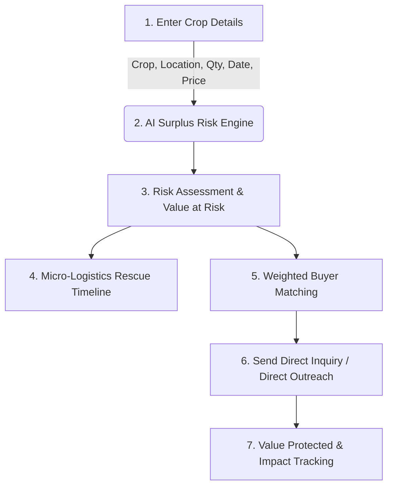

# 🌱 Harvest Bridge — AI Post-Harvest Surplus & Loss Mitigation Platform

> **Predict · Redirect · Protect**  
> *Transforming agricultural surplus risk into immediate economic security for smallholder farmers.*

---

## 📌 Executive Summary

Every harvest season, millions of tons of fresh produce rot in fields due to sudden market gluts, localized price crashes, and lack of timely access to buyers. **Harvest Bridge** is an intelligent, context-aware agricultural assistant and surplus redistribution platform built to eliminate post-harvest loss before it occurs.

By combining **Surplus Risk Prediction**, **Multi-Factor Buyer Matching**, **AI-Assisted Outreach**, and **Micro-Logistics Rescue Timelines**, Harvest Bridge empowers smallholder farmers, FPOs (Farmer Producer Organizations), and regional agricultural extension workers to protect crop value and route excess yield directly to institutions, food processors, and local retailers.

---

## 🎯 1. Chosen Vertical

* **Category**: Agritech / Post-Harvest Loss Mitigation & Supply Chain Intelligence
* **Target Personas**:
  * **Smallholder Farmers & FPO Managers**: Seeking early warning on surplus risks and pre-harvest buyer connections.
  * **Institutional Buyers & Food Processors**: Looking for transparent, localized sourcing of fresh produce at fair rates.
  * **Agricultural Extension Officers**: Monitoring district-level surplus radar to coordinate regional interventions.

---

## 🧠 2. Approach & Technical Logic

Harvest Bridge uses a multi-layered algorithm structure to evaluate agricultural context, assess risk, and execute matches:

### A. Deterministic Surplus Risk Engine (`surplusEngine.ts`)
Calculates a crop's **Surplus Risk Score (0–100%)** and **Price Risk Score (0–100%)** based on:
1. **Perishability Index ($P$)**: Crop-specific shelf life decay curves (e.g., Tomato $0.85$, Leafy Greens $0.90$, Potato $0.25$).
2. **Seasonal Supply Pressure ($S$)**: Historical harvest influx metrics by district and month.
3. **Rescue Window Calculation**: $\text{Days to Harvest} = \text{Harvest Date} - \text{Current Date}$.
4. **Value & Quantity at Risk**: Conservative impact modeling calculating financial exposure prior to harvest.

$$\text{Risk Base} = (S \times 0.50) + (P \times 0.25) + \text{Quantity Factor} + \text{Timing Factor}$$

### B. Multi-Factor Buyer Matching Engine (`matchingEngine.ts`)
Matches high-risk produce with nearby registered buyers using a weighted multi-dimensional compatibility algorithm:
* **Crop Compatibility (20%)**: Direct alignment with buyer's required commodities.
* **Quantity Compatibility (25%)**: Ratio of farmer harvest volume to buyer daily absorption capacity.
* **Geographic Proximity (20%)**: Distance decay calculation prioritizing local pickup within 15–50 km.
* **Timing Alignment (20%)**: Synchronization between expected harvest date and buyer demand window.
* **Price Compatibility (15%)**: Overlap between farmer target price and buyer's preferred price range.

### C. Context-Aware AI Assistant (`assistantService.ts`)
An integrated smart assistant capable of understanding farmer queries regarding harvest timing, crop storage advice, market price trends, and buyer negotiation guidance in natural language.

---

## 🚀 3. How the Solution Works

### Step-by-Step User Journey



1. **Check Surplus Risk**: The farmer or FPO inputs crop type, location, yield volume, expected harvest date, and expected price.
2. **Visual Breakdown**: The system outputs an explainable risk breakdown, identifying primary risk factors.
3. **Rescue Window**: Displays an actionable timeline (e.g., "4 days remaining before quality degradation begins").
4. **Instant Matchmaking**: Ranked list of verified buyers with complete match score transparency.
5. **One-Click Inquiry**: Farmers send direct interest notifications to buyers, protecting yield value immediately.

---

## 🏗️ 4. Project Folder & Workspace Architecture

The repository is organized into clean, decoupled `frontend` and `backend` workspaces:

```
harvest-bridge/
├── backend/
│   ├── index.js             # Express API server (REST Endpoints)
│   ├── test-engine.js       # Core engine unit test suite
│   ├── package.json         # Backend node dependencies
│   └── .env                 # Backend environment setup
│
├── frontend/
│   ├── public/              # Static assets and icons
│   ├── src/                 # React 19 + TypeScript source code
│   │   ├── components/      # UI components & Leaflet maps
│   │   ├── data/            # Demo data & seed records
│   │   ├── hooks/           # App state reducer & context
│   │   ├── pages/           # Application views
│   │   ├── services/        # AI engines (Surplus & Matching)
│   │   ├── types/           # TypeScript type definitions
│   │   └── utils/           # Formatting & helper utilities
│   ├── index.html           # HTML entry point
│   ├── vite.config.ts       # Vite build configuration
│   ├── tailwind.config.js   # Design system theme
│   └── package.json         # Frontend node dependencies
│
├── package.json             # Root monorepo workspace configuration
├── Dockerfile               # Multi-stage production container
└── README.md                # Project documentation
```

---

## 🛠️ 5. Local Setup & Running Instructions

### Prerequisites
* **Node.js**: v18.x or higher
* **npm**: v9.x or higher

### Installation & Launch

1. **Clone & Navigate**:
   ```bash
   git clone <repository-url>
   cd harvest-bridge
   ```

2. **Install Workspace Dependencies**:
   ```bash
   npm install
   ```

3. **Start Express API Server (Backend)**:
   ```bash
   npm start
   # or npm run server
   ```
   *(API Server runs on `http://localhost:3001`)*

4. **Start Vite Development Server (Frontend)**:
   ```bash
   npm run dev
   ```
   *(Frontend App runs on `http://localhost:5173`)*

5. **Run Core Engine Unit Tests**:
   ```bash
   npm test
   ```

---

## ☁️ 6. Deployment Guide

### Option 1: Render.com (Recommended Free Cloud Hosting)

1. **Deploy Backend API (Web Service)**:
   - Create a **Web Service** on Render connected to your GitHub repo.
   - **Root Directory**: `backend`
   - **Build Command**: `npm install`
   - **Start Command**: `node index.js`
   - **Environment Variables**: `PORT=3001`, `DEMO_MODE=true`

2. **Deploy Frontend (Static Site)**:
   - Create a **Static Site** on Render.
   - **Root Directory**: `frontend`
   - **Build Command**: `npm install && npm run build`
   - **Publish Directory**: `dist`

---

### Option 2: Vercel (Frontend) + Render / Railway (Backend)

1. **Frontend (Vercel)**:
   - Import your repository into Vercel.
   - Set **Root Directory** to `frontend`.
   - Vercel automatically detects Vite. Set Build Command to `npm run build` and Output Directory to `dist`.

2. **Backend (Render / Railway / Fly.io)**:
   - Deploy `backend/index.js` as a Node service on Render or Railway.

---

### Option 3: Docker Container Deployment

Build and run using the multi-stage `Dockerfile`:

```bash
# 1. Build Production Docker Image
docker build -t harvest-bridge .

# 2. Run Container on Port 3001
docker run -d -p 3001:3001 --name harvest-bridge-app harvest-bridge
```

---

## 📄 License
Released under the MIT License. Developed for the AI Hackathon Challenge.
